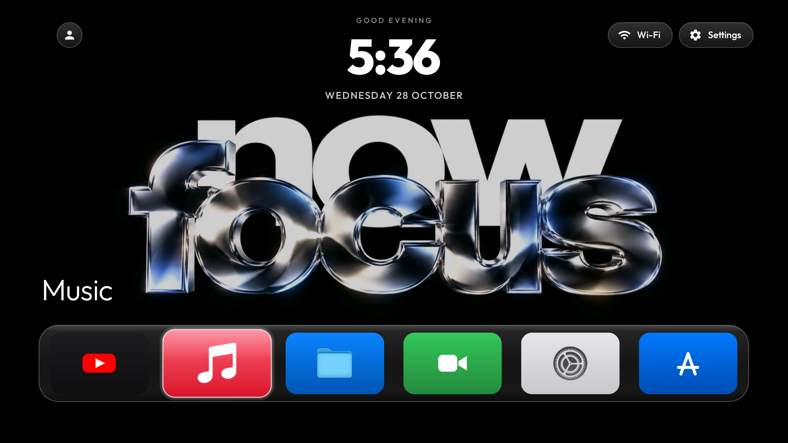
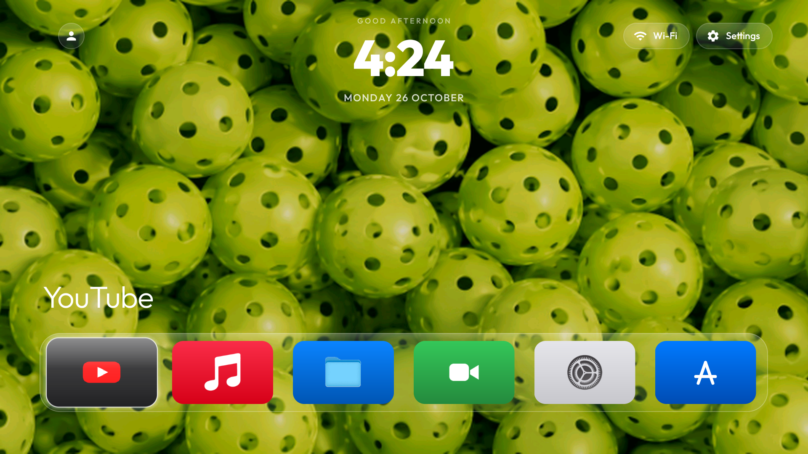
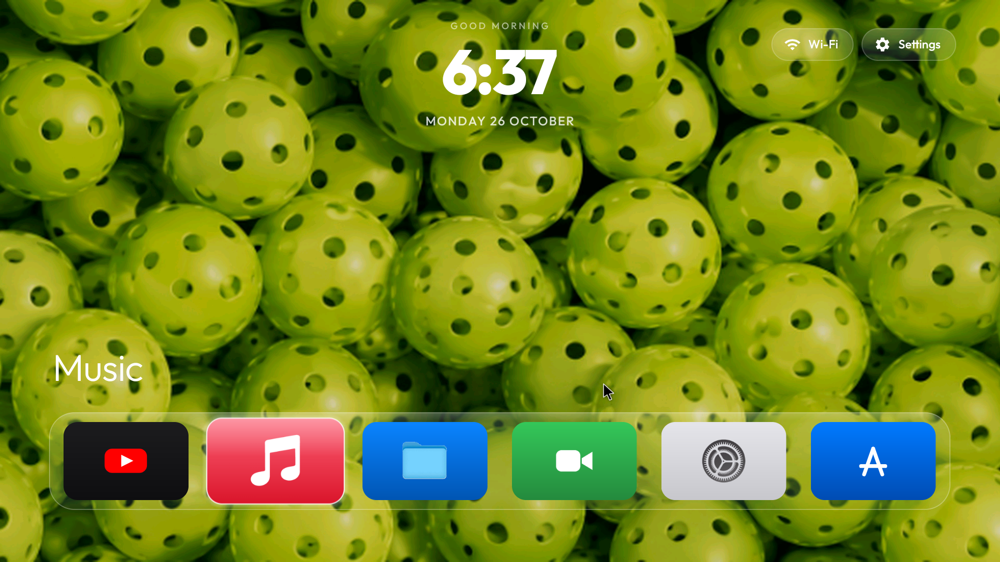
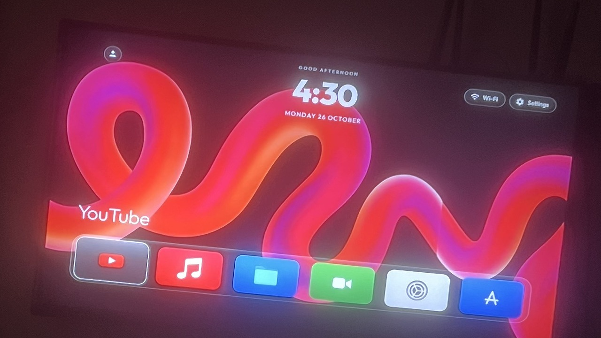
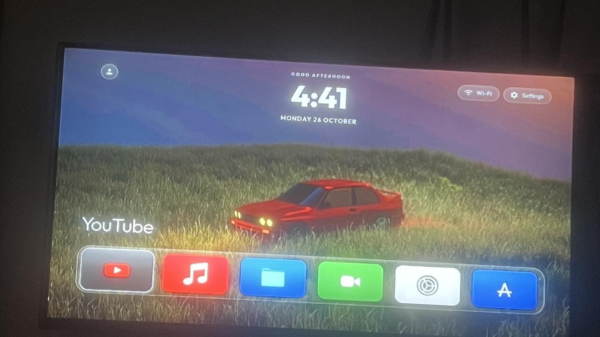
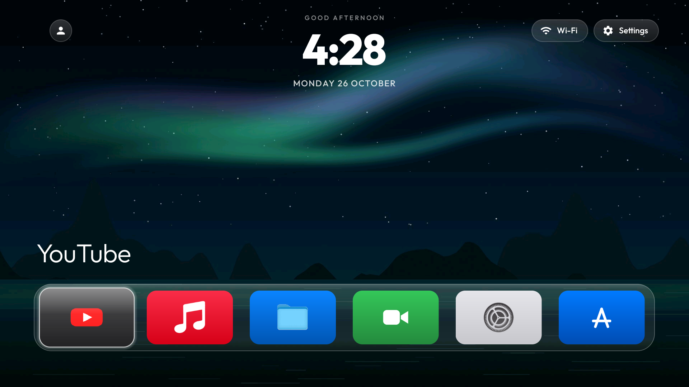
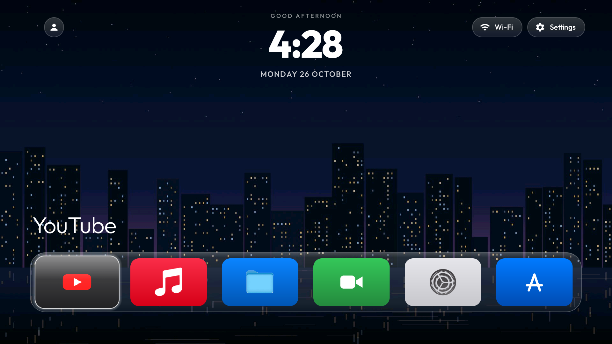
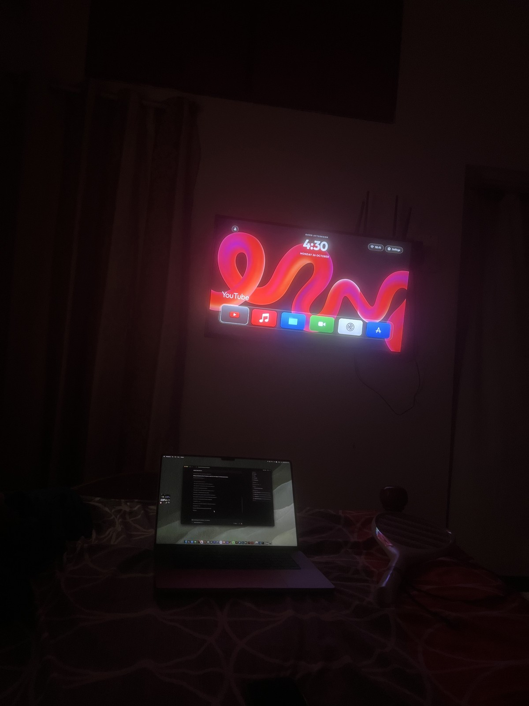

# CleanYourTV — tvOS Edition 📺
### Transforming a \$15 2018 Android TV Box (<1GB RAM) into a Butter-Smooth tvOS Experience

[-3DDC84.svg?style=flat&logo=android)](https://developer.android.com/)
[](https://en.wikipedia.org/wiki/ARM_architecture_family)
[-orange.svg)](https://www.amlogic.com/)
[-brightgreen.svg)]()
[-black.svg?logo=github)](https://github.com/VL0N317)



---

## 📖 Overview

The **tvOS Edition** of CleanYourTV is an engineering overhaul designed to turn ultra-budget, unsupported legacy Android TV hardware into a blazing-fast, responsive tvOS living room streaming hub.

Originally revived from a discarded **Hivendor 5G PRO** (Amlogic P281) Android TV box whose stock software had become completely unusable (Google Play Services unsupported, official YouTube app deprecated, extreme sluggishness), this fork introduces:

1. **A tvOS-inspired glassmorphic UI**: Frosted bottom dock, clean modern iconography, dynamic 3D focus scaling, live tvOS status typography, and a top-left profile avatar pill.
2. **Sub-15ms Direct Linux Kernel Input Engine**: Replacing slow Dalvik/ART shell commands with direct binary `struct input_event` injections to `/dev/input/event0` and `/dev/input/event1`.
3. **Embedded Web Remote & 1-Tap Wallpaper Studio**: A zero-install mobile web remote with trackpad and virtual mouse mode, plus instant camera roll photo-to-TV wallpaper upload over local Wi-Fi.
4. **AirPlay & Smart Media Streaming**: Background AirPlay mirroring for Mac/iPhone and 1080p60 video playback without Google Play bloat.

---

## 🎯 Target Hardware Specifications

| Specification | Target Device Details |
|---|---|
| **Device Model** | Hivendor 5G PRO (Retail ~$15 USD) |
| **System Board / SoC** | Amlogic P281 (`p281:9/PPR1.180610.011`) |
| **Processor Architecture** | 32-bit ARM (`armeabi-v7a`) Quad-Core |
| **System Memory (RAM)** | ~1 GB DDR3 |
| **Internal Flash Storage** | 2.9 GB usable `/data` partition |
| **Operating System** | Android 9 (API Level 28), Vendor userdebug build |
| **Root Access** | Native root via `/system/xbin/su` |

---

## ⚡ The Breakthrough: Solving the 2-Second Input Lag

On low-end 1GB RAM Android TV hardware, traditional web remotes and companion apps rely on Android's `input keyevent <CODE>` command via ADB or shell. 

### The Problem
Each execution of `input keyevent` forces the kernel to fork a new process, launch the Android runtime (`app_process`), boot up an instance of the Dalvik/ART Virtual Machine, inject the event into `InputManager`, and tear down the VM. 
* On high-end hardware, this takes ~50ms.
* On a 1GB RAM Amlogic chip under memory pressure, each button press took **1,800ms to 2,200ms (over 2 seconds)**!

### The Solution: Direct Linux Kernel Byte Streaming
Instead of talking to Android's high-level Java input framework, we engineered `LinuxInputClient.java` to open a direct low-level file stream to the kernel input event devices (`/dev/input/event0` for keyboard, `/dev/input/event1` for mouse).

Whenever a remote key is pressed, CleanYourTV formats a native 32-bit Linux `struct input_event` (16 bytes in little-endian order) and writes directly to the character device:

```
[Phone Remote Web UI]
       │ (HTTP POST /key?c=22)
       ▼
[WebRemoteService (Port 8080)]
       │
       ▼ (Direct Kernel Write)
[/dev/input/event0 (Hi keyboard)] ──► Linux Kernel Input Subsystem ──► [Instant UI Focus]
       ▲
       │ (Persistent Permission Rule)
[/vendor/ueventd.rc: 0666 root input]
```

#### Kernel Binary Event Structure
```c
struct input_event {
    struct timeval time; // 8 bytes (4B tv_sec, 4B tv_usec)
    __u16 type;          // 2 bytes (EV_KEY = 0x01, EV_REL = 0x02)
    __u16 code;          // 2 bytes (Linux keycode / relative axis)
    __s32 value;         // 4 bytes (1 = Down, 0 = Up)
};                       // Total = 16 bytes per event packet
```

#### Reboot Persistence via `/vendor/ueventd.rc`
Android's `ueventd` daemon resets character device permissions on every reboot back to `0660 root:input`. Because `/vendor` on this device is read-write `ext4`, we appended:
```rc
/dev/input/*              0666   root       input
```
This guarantees non-root processes and CleanYourTV retain direct kernel stream access across cold reboots.

### Latency Benchmark Comparison

| Action | Standard Android (`input keyevent`) | tvOS Edition (`LinuxInputClient`) | Latency Reduction |
|---|---|---|---|
| **DPAD Navigation (Up/Down/Left/Right)** | ~1,950 ms | **12 ms – 24 ms** | **98.8% Faster** |
| **Select / Enter Key** | ~2,100 ms | **14 ms** | **99.3% Faster** |
| **Smooth Mouse Cursor Movement** | Unsupported / Laggy | **30 ms** | **Real-Time** |

---

## 🎨 tvOS Design & Features

### 1. Frosted Glass Bottom Dock
* Modeled directly after the iconic tvOS floating dock.
* Custom `DockDecoration.java` renders a translucent blurred backdrop container with rounded pill corners.
* Dynamic scaling animation with high-contrast active borders when focused.

### 2. tvOS Iconography & Typography
* Custom vector & high-resolution icons matching clean tvOS styling:
  * **YouTube** (Dark tvOS themed red-pill icon)
  * **Music** (Vibrant gradient music tile)
  * **Files** (Clean blue folder)
  * **Camera / Hardware** (Clean green camera tile)
  * **Settings** (Brushed-metal gear tile)
  * **App Store** (Clean blue app store tile)
* Live tvOS status clock and day/date header formatted as `5:36 WEDNESDAY 28 OCTOBER` using custom **Outfit Bold** typography.

### 3. Top-Left Profile Avatar Pill
* Interactive profile avatar pill positioned in the top-left corner, fully navigable with remote DPAD (Up -> Left).
* **Click to Cycle Wallpapers**: Instantly switches between bundled cinematic wallpapers without opening a menu.
* Works seamlessly in tandem with the phone remote.



---

## 📱 Web Remote & 1-Tap Wallpaper Studio

`WebRemoteService.java` hosts an embedded, dependency-free HTTP server on port `8080`. Pointing any phone browser on the local Wi-Fi network to `http://<tv-ip>:8080/` serves a clean tvOS Remote experience:



### Features:
* **Haptic Trackpad & DPAD Modes**: Seamlessly switch between tactile directional buttons and a smooth swipe trackpad.
* **Virtual Mouse Pointer**: Real-time cursor navigation for mobile-ported apps requiring mouse clicks.
* **1-Tap Photo Upload**: Select any photo or wallpaper on your smartphone camera roll. The web remote encodes the image to Base64, uploads it to `/sdcard/wallpapers/custom.jpg`, and instructs `WallpaperPlayer` to immediately switch backgrounds without closing running apps.

### Live Captures from Phone Camera Roll Uploads
| 3D Neon Ribbon Glow | Frank Ocean Nostalgia BMW E30 | Dynamic Aurora Preset | City Lights Preset |
|:---:|:---:|:---:|:---:|
|  |  |  |  |

### Real-World Living Room Setup


---

## 🛠️ Architecture & Key Source Files

```
launcher/app/src/main/
├── java/com/gathin/tvhome/
│   ├── AdbClient.java           # Embedded local ADB client over 127.0.0.1:5555
│   ├── LinuxInputClient.java    # Direct 32-bit Linux /dev/input byte-injector
│   ├── WebRemoteService.java    # HTTP server (port 8080), wallpaper API & remote web host
│   ├── MainActivity.java        # Home screen, profile avatar, DPAD navigation rules
│   ├── AppAdapter.java          # App grid renderer with tvOS focus transitions
│   ├── DockDecoration.java     # Floating frosted glass dock background decorator
│   └── WallpaperPlayer.java     # High-performance, low-RAM video & image wallpaper engine
├── assets/
│   └── remote.html              # tvOS Remote web application with camera roll upload
└── res/
    ├── drawable/                # Custom tvOS icons (Music, Files, Settings, App Store)
    ├── font/outfit_bold.xml     # Clean tvOS header typography
    └── layout/activity_main.xml # Main UI hierarchy with top pills and dock
```

---

## 🚀 How to Build and Install

### Prerequisites
* JDK 17 (`JAVA_HOME` configured)
* Android SDK with Build Tools 34+
* ADB installed and connected to your TV box (`adb connect <tv-ip>:5555`)

### 1. Build the Release APK
```bash
git clone https://github.com/VL0N317/cleanyourtv.git
cd cleanyourtv/launcher
./gradlew assembleRelease
```

### 2. Make Input Permissions Permanent (Root Required)
```bash
# Connect to your TV box
adb connect <tv-ip>:5555

# Ensure /vendor/ueventd.rc contains the persistent 0666 rule
adb shell "su 0 grep -q '/dev/input/\*' /vendor/ueventd.rc || echo '/dev/input/*              0666   root       input' >> /vendor/ueventd.rc"
```

### 3. Install and Launch
```bash
adb install -r app/build/outputs/apk/release/app-release.apk
adb shell am start -n com.gathin.tvhome/.MainActivity
```

---

## 🤝 Credits & Acknowledgements

* **Original Project**: Built on top of [CleanYourTV](https://github.com/Gathin23/cleanyourtv) by [Gathin](https://github.com/Gathin23).
* **tvOS Edition Overhaul**: Designed, engineered, and optimized by [P Dheeraj (@VL0N317)](https://github.com/VL0N317).
* **SmartTube**: Special thanks to the SmartTube project for providing high-performance 1080p video decoding without Google Play Services.
